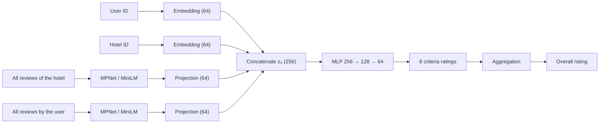

# Dual-Side Semantic NCF-AG

**Enhancing Neural Collaborative Filtering by Aggregation with Dual-Side Semantic Review Embeddings**

Graduation research thesis by **San Tana**, advised by **Kanshin Bou**
National Institute of Technology, Tsuyama College, Department of Integrated Science and Technology, Communication and Information Systems Program
January 22, 2026

**[View the interactive project page →](https://tana-jouhou72.github.io/ncf-thesis-viz/)**

The page is in **English and Japanese**. Use the EN / 日本語 switch in the top bar, or link straight to the Japanese version: [`?lang=ja`](https://tana-jouhou72.github.io/ncf-thesis-viz/?lang=ja)

---

## In one paragraph

Most recommender systems learn only from star ratings and ignore the reviews people write. This thesis adds review text to **NCF-AG**, a strong multi-criteria neural recommender. Every hotel gets a semantic profile built from all its reviews, and every user gets one built from everything they have written, using Sentence-Transformer embeddings (**MPNet** or **MiniLM**). The proposed **Dual-Side** model fuses both profiles with the usual user and hotel ID embeddings. On 3 million TripAdvisor ratings it reaches a **test RMSE of 0.8163**, 4.47% lower than the NCF-AG baseline. The key finding: **a user's own reviews predict their ratings better than the hotel's reviews do.**

## How the model works



- **Input:** the four parts are joined into one 256-number vector, z₀ = p_u ⊕ q_i ⊕ t′_i ⊕ t′_u.
- **Projection:** text embeddings (768 or 384 numbers) are compressed to 64 by a learned layer, t′ = ReLU(W·e + b), so they don't drown out the ID embeddings.
- **Prediction:** like NCF-AG, the model first predicts six criteria (service, cleanliness, value, sleep quality, rooms, location), then aggregates them into the overall rating.

Four architectures share this backbone and differ only in their input:

| Model | Input | Size |
|---|---|---|
| Baseline NCF-AG | user ID + hotel ID | 128 |
| Item-Text hybrid | + hotel review profile | 192 |
| User-Text hybrid | + user review profile | 192 |
| **Dual-Side (proposed)** | + both profiles | **256** |

## Results

Test RMSE, lower is better (Table 2 in the thesis):

| Model | MiniLM (384-dim) | MPNet (768-dim) |
|---|---:|---:|
| Matrix Factorization | 2.0657 | 2.0657 |
| Baseline NCF-AG | 0.8441 | 0.8545 |
| Item-Text hybrid | 0.8362 | 0.8402 |
| User-Text hybrid | 0.8303 | 0.8245 |
| **Dual-Side (proposed)** | **0.8258** | **0.8163** |

Matrix Factorization uses no text, so it has a single result.

Improvement over NCF-AG, computed from the table above:

| Model | MiniLM | MPNet |
|---|---:|---:|
| Item-Text hybrid | 0.94% | 1.67% |
| User-Text hybrid | 1.63% | 3.51% |
| **Dual-Side** | **2.17%** | **4.47%** |

**What this shows**

- **User text matters more than hotel text.** With MPNet, user reviews alone cut the error about twice as much as hotel reviews. A user's writing reveals a "rating persona": what they care about and how strictly they rate.
- **Fusing both sides works best**, with both embedding models.
- **Every criterion improves,** most of all the subjective ones, Value and Service.
- **There is a size trade-off.** MPNet is the most accurate; MiniLM is close behind with half-size vectors, less memory and faster training.

## Data and setup

- **Dataset:** [HotelRec](https://github.com/Diego999/HotelRec), about 50 million TripAdvisor reviews in a 40 GB JSON file.
- **Pre-processing:** streamed one review at a time, then:
  - kept only reviews with text and all six criteria ratings,
  - applied a 5-core filter (every user and hotel has at least 5 interactions).

| Statistic | Value |
|---|---|
| Users | 366,058 |
| Hotels | 122,376 |
| Ratings | 3,029,888 |
| Criteria | 6 |
| Sparsity | 99.99% |

- **Split:** 70% train, 10% validation, 20% test, with a fixed random seed.
- **Model:** 64-dim embeddings, MLP 256 → 128 → 64 with ReLU and dropout 0.5.
- **Training:** AdamW (learning rate 0.0005, weight decay 0.0001), batch size 1,024, early stopping, PyTorch.
- **Loss:** MSE on the overall rating plus a weighted MSE on the six criteria.
- **Metric:** test RMSE.

## About this repository

This repo holds the project page: a single static website with no build step.

```
ncf-thesis-viz/
├── index.html      the whole page: content, styles and scripts
├── assets/         figures from the thesis (learning curves, MF curve, per-criterion radar)
└── README.md
```

- **Charts** are drawn with [Chart.js](https://www.chartjs.org/) from the exact numbers in Table 2.
- **Equations** are rendered with [KaTeX](https://katex.org/).
- **Fonts** are IBM Plex Sans, IBM Plex Sans JP and Source Serif 4 from Google Fonts.
- **Languages:** English and Japanese text are both in `index.html`, with each element marked `data-l="en"` or `data-l="ja"`. The switch shows one language and remembers the choice; it uses the browser language on the first visit.
- The page works on phones and supports dark mode.

**Run it locally:** open `index.html` in a browser, or serve the folder:

```bash
python3 -m http.server 8000   # then open http://localhost:8000
```

**Publish it:** in the repo, go to **Settings → Pages → Deploy from a branch**, choose `main` and `/ (root)`, and click **Save**.

## References

1. He, X., Liao, L., Zhang, H., et al. *Neural Collaborative Filtering.* arXiv:1708.05031 (2017).
2. Morise, H., Atarashi, K., Oyama, S., et al. *Neural collaborative filtering with multicriteria evaluation data.* Applied Soft Computing, 119, 108548 (2022).
3. Diego999. *HotelRec: a large-scale hotel reviews dataset.* github.com/Diego999/HotelRec.
4. Reimers, N., Gurevych, I. *Sentence-BERT: Sentence Embeddings using Siamese BERT-Networks.* EMNLP (2019).
5. Song, K., Tan, X., Qin, T., Lu, J., Liu, T.-Y. *MPNet: Masked and Permuted Pre-training for Language Understanding.* NeurIPS 33 (2020).
6. Koren, Y., Bell, R., Volinsky, C. *Matrix factorization techniques for recommender systems.* Computer, 42(8), 30–37 (2009).

---

© 2026 San Tana
